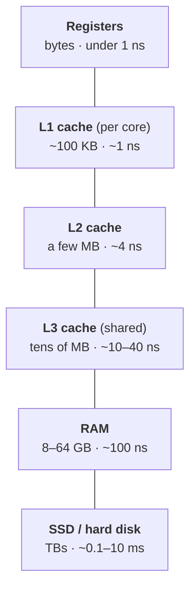
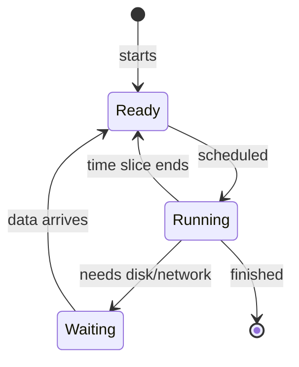
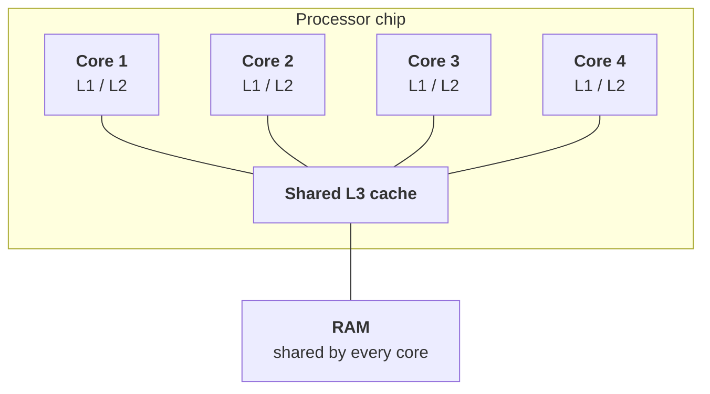
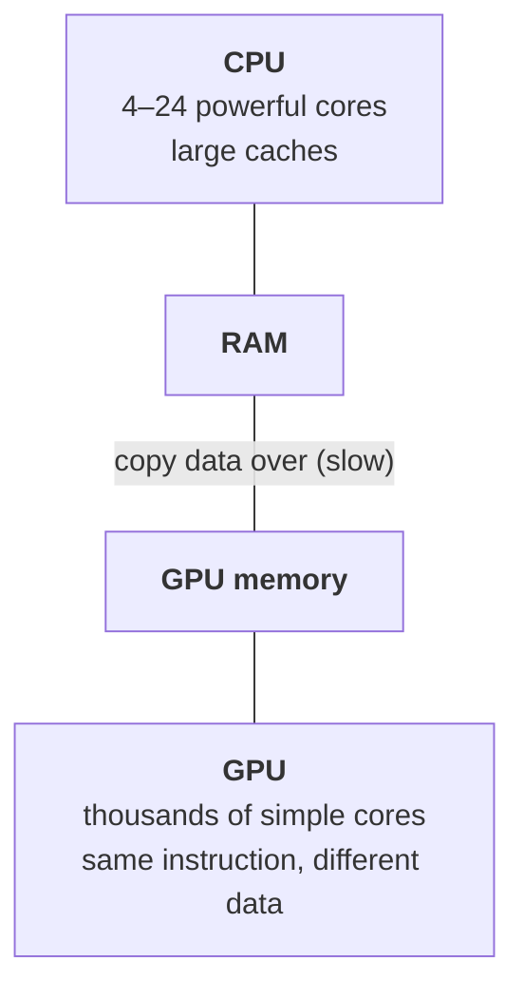

# Computer Architecture

---
level: 3
---

# Why care about architecture?

- Two things decide how fast our code runs:
  - How fast the processor can do arithmetic
  - How fast it can get the data it needs to do that arithmetic
- Usually the second one is the bottleneck!
- A rough mental model of the hardware helps explain things that seem like magic:
  - Why vectorized code is fast
  - Why `apply(X, MARGIN = 2, ...)` over columns is quicker than over rows
  - Why parallel code is never as fast as we hope
- Four pieces today: memory, scheduling, multiple cores, and GPUs

---
level: 3
---

# The memory hierarchy

- Data lives in layers, from small and fast to big and slow
- If an L1 read took **1 second**, RAM would take **2 minutes** and an SSD **a day**
- Data moves in chunks, so neighboring values come along for free
  - `R` stores vectors and matrix columns contiguously
- Run out of RAM and the computer falls back on the disk: everything crawls

Typical numbers; they vary by machine

---
level: 3
---

# Processes and scheduling

- Your computer runs hundreds of _processes_, but each core runs one at a time
- The operating system's _scheduler_ gives each a time slice of a few milliseconds, then switches
- Why it matters for us:
  - More workers than cores just take turns
  - Other programs compete for the same cores, so timings vary
- HPC clusters have a scheduler too (like Slurm) that hands out cores to jobs

---
level: 3
---

# Multi-core processors

- A processor has several _cores_, each running its own process
- Each core has small private caches; all cores share the big cache and RAM
- `R` is _single-threaded_: one session uses one core
- Parallel `R` starts several `R` processes, one per core
- Speedups fall short because workers compete for shared memory, and some chips mix fast and slow cores (my laptop has 4 of each)

---
level: 3
---

# CPUs vs GPUs

- A **CPU** has a few powerful cores, good at complicated, step-by-step logic
- A **GPU** has thousands of simple cores running the _same_ instruction on _different_ data
  - Built for graphics (matrix arithmetic), which is why they're great for deep learning
- Data must be copied to the GPU's own memory first, which is slow
- So GPUs only help with big, uniform arithmetic; base `R` doesn't use them (`torch` does)

